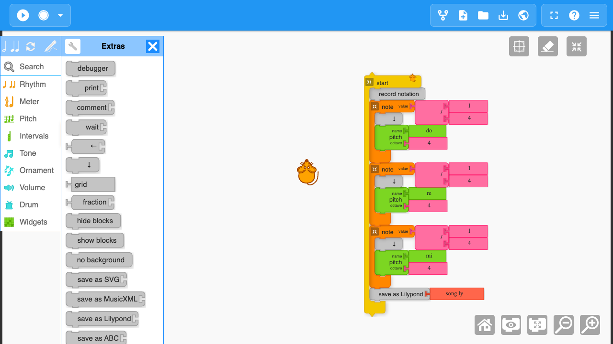
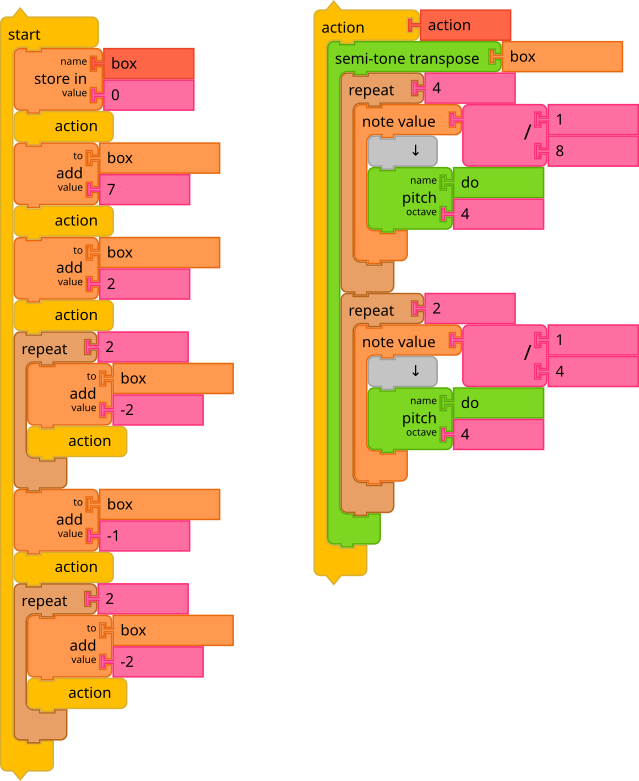
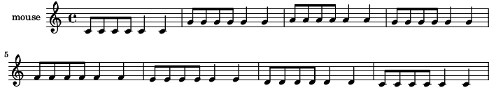

# LilyPond with Music Blocks software

[LilyPond](http://www.lilypond.org/) is a music engraving program, devoted to producing the highest-quality sheet music possible. It brings the aesthetics of traditionally engraved music to computer printouts. LilyPond is Free/Libre Software (part of the [GNU Project](https://en.wikipedia.org/wiki/GNU_Project)). We use it with [Music Blocks software](https://sugarlabs.github.io/musicblocks/) in order to export the user-generated music to sheet music.

## Overview
We will use Music Blocks to create the music and then convert that to sheet music. For that:

1. Using Music Blocks create the desired music.
2. [Export the LilyPond code](#generating-lilypond-files-from-music-blocks).
3. [Download Lilypond](#downloading-lilypond) (In order to turn the LilyPond code into Printable Standard Music Notation).
4. Download [Frescobaldi](#using-frescobaldi) (if desired).

## Prerequisites
* Basic knowledge of [Music Blocks software](http://musicblocks.net/)
* Curiosity about [sheet music](https://en.wikipedia.org/wiki/Sheet_music)

## Downloading LilyPond
Lilypond may be downloaded for Windows, Mac, and GNU/Linux from [LilyPond download page](https://lilypond.org/download.html)

## Generating LilyPond files from Music Blocks

There are two ways to save a `.ly` file. Both are only available in Advanced Mode.

### From the Save menu

Choose **Save sheet music as Lilypond** from the Save menu. A dialog asks for a file name, a title and an author, and you can also add MIDI output and guitar tablature. Music Blocks then runs your project again and writes down the notes it plays. This works for a project that plays the same music every time.

### From blocks in your program

For an interactive program, such as a game, use the **record notation** block where recording should start. The notes the mouse plays after it are recorded. The **save as Lilypond** block saves what has been recorded so far to the file named in the block. A program can save more than once, for example at the end of each level. Each mouse records its own part, and every run starts a new recording. Both blocks are on the Extras palette.

</img>

Running this program downloads `song.ly`.

## Using LilyPond

If you would rather not use the command line, [Frescobaldi](#using-frescobaldi) can install LilyPond for you and engrave your files.

### For GNU/Linux

1. Install LilyPond from your distribution's packages (for example `sudo apt install lilypond`) or from the [LilyPond download page](https://lilypond.org/download.html).
2. Open a terminal and go to the folder with your `.ly` file (by default `~/Downloads`).
3. Run `lilypond filename.ly`. This creates `filename.pdf` in the same folder.

### For macOS

1. Install LilyPond with [Homebrew](https://brew.sh/) (`brew install lilypond`) or [MacPorts](https://www.macports.org/) (`sudo port install lilypond`), or download the macOS archive from the [LilyPond download page](https://lilypond.org/download.html) and unpack it.
2. Open Terminal and go to the folder with your `.ly` file (by default `~/Downloads`).
3. Run `lilypond filename.ly`. If you unpacked the archive, use the full path instead, for example `~/lilypond-x.y.z/bin/lilypond filename.ly`. This creates `filename.pdf` in the same folder.

### For Windows

1. Download the Windows `.zip` from the [LilyPond download page](https://lilypond.org/download.html) and unpack it, for example to `C:\lilypond-x.y.z`.
2. Open Command Prompt and go to the folder with your `.ly` file.
3. Run `C:\lilypond-x.y.z\bin\lilypond filename.ly`. This creates `filename.pdf` in the same folder.

## Using Frescobaldi

Optionally, you can install [Frescobaldi](https://frescobaldi.org/), an editor for LilyPond files. It shows your code and the sheet music side by side, and it can download and install LilyPond for you.

1. Install Frescobaldi:
    - Windows: download the `.msi` file from the [Frescobaldi releases page](https://github.com/frescobaldi/frescobaldi/releases) and run it.
    - macOS: download the `.dmg` file from the [Frescobaldi releases page](https://github.com/frescobaldi/frescobaldi/releases), or run `brew install --cask frescobaldi`.
    - GNU/Linux: install it from your distribution's packages or from [Flathub](https://flathub.org/apps/org.frescobaldi.Frescobaldi).
2. Open Frescobaldi, open its preferences and choose **LilyPond Preferences**. If no LilyPond version is listed, click **Add** to download one.
3. Open your `.ly` file and click the LilyPond button in the toolbar. The sheet music appears next to the code.

## Editing LilyPond Files
### Editing the header
You can customize your LilyPond output by adding your own name, the title of your musical creation, and your intended copyright to the `.ly` file. To do so, open `filename.ly` in a text editor and change the header, e.g.,
```
\header {
   dedication = "To my best friend Someone"
   title = "The Last One"
   subtitle = "Breathless"
   instrument = "Guitar"
   composer = "Mr. ABC XYZ"
   copyright = "Mr. Mouse (c) 2015 -- CC-BY-SA"
   tagline = "Made from Music Blocks v.0.9"
}
```
### Editing other fields
Similarly, you can change the meter, add [MIDI instruments](http://lilypond.org/doc/v2.18/documentation/notation/midi-instruments), add a Guitar Tab Section, and add MIDI Section.
**Note**: Comments in `.ly` files are made by using a `%` at the start of a line of text.

### References
More customization details are found in the .ly file. Further references include:
* [Text Input](http://lilypond.org/text-input.html)
* [Learning Manual](http://lilypond.org/doc/v2.18/Documentation/learning/index.html)
* [Music Glossary](http://www.lilypond.org/doc/v2.19/Documentation/music-glossary/)
* [Freely sharable music notation generated with LilyPond](http://www.mutopiaproject.org/)
* [Lilypond output in a web browser](https://www.tunefl.com/)

## Example: Making a `.ly` file from Music Blocks and Output
</img>

Saving the program above with **Save sheet music as Lilypond** from the Save menu
gives `hotdog.ly`:

```
\version "2.18.2"

mouse = {
c'8 c'8 c'8 c'8 c'4 c'4 g'8 g'8 g'8 g'8 g'4 g'4 a'8 a'8 a'8 a'8 a'4
a'4 g'8 g'8 g'8 g'8 g'4 g'4 f'8 f'8 f'8 f'8 f'4 f'4 e'8 e'8 e'8 e'8
e'4 e'4 d'8 d'8 d'8 d'8 d'4 d'4 c'8 c'8 c'8 c'8 c'4 c'4
}

\score {
<<
\new Staff = "treble" {
\clef "treble"
\set Staff.instrumentName = #"mouse" \mouse
}
>>
\layout { }
}
```

</img>

## Example: Blank `.ly` file
```
\version "2.18.2"

% <comments removed>
\header {
   dedication = "Made with LilyPond and Music Blocks (https://musicblocks.sugarlabs.org)"
   title = "My Music Blocks Creation"
%   subtitle = "Subtitle"
%   instrument = "Instrument"
   composer = "Mr. Mouse"
%   arranger = "Arranger"
   copyright = "Mr. Mouse (c) 2015 -- CC-BY-SA"
   tagline = "Made from Music Blocks v.0.9"
}

meter = {
   \time 3/4
   \key c \minor
   \numericTimeSignature
   \partial 4 
   \tempo "Andante" 4=90
}

\score {
   <<


% GUITAR TAB SECTION
% Delete the %{ and %} below to include guitar tablature output.
%{
      \new TabStaff = "guitar tab" 
      <<
         \clef moderntab
      >>
%}

   >>
   \layout {}

% MIDI SECTION
% Delete the %{ and %} below to include MIDI output.
%{
\midi {
   \tempo 4=90
}
%}

}

% MUSIC BLOCKS CODE
% Below is the code for the Music Blocks project that generated this Lilypond file.
%{

[[0,["start",{"collapsed":false,"xcor":0,"ycor":0,"heading":0,"color":0,"shade":50,"pensize":5,"grey":100}],250,150,[null,null,null]],
[1,["pitch",{}],705.5,128.5,[null,2,3,null]],
[2,["solfege",{"value":"sol"}],779,128.5,[1]],
[3,["number",{"value":4}],779,160,[1]],
[4,["savelilypond",{}],324.5,363.5,[null,5,null]],
[5,["text",{"value":"tada.ly"}],458,363.5,[4]]]
%}

```

## Testing
You can use the following two files `test1.ly` and `test2.ly` to check if LilyPond and Frecobaldi installed properly:

**test1.ly**
```
\version "2.18.2"
{
  c' e' g' e'
}

```

**test2.ly**
```
\version "2.18.2"

mouse = {
c'8 c'8 c'8 c'8 c'4 c'4 g'8 g'8 g'8 g'8 g'4 g'4 a'8 a'8 a'8 a'8 a'4
a'4 g'8 g'8 g'8 g'8 g'4 g'4 f'8 f'8 f'8 f'8 f'4 f'4 e'8 e'8 e'8 e'8
e'4 e'4 d'8 d'8 d'8 d'8 d'4 d'4 c'8 c'8 c'8 c'8 c'4 c'4
}

\score {
<<
\new Staff = "treble" {
\clef "treble"
\set Staff.instrumentName = #"mouse" \mouse
}
>>
\layout { }
}

```

# License
This work is licensed under the [Creative Commons Attribution 4.0 International License](http://creativecommons.org/licenses/by/4.0/)

### Contributors:
Daksh Shah - 2015
